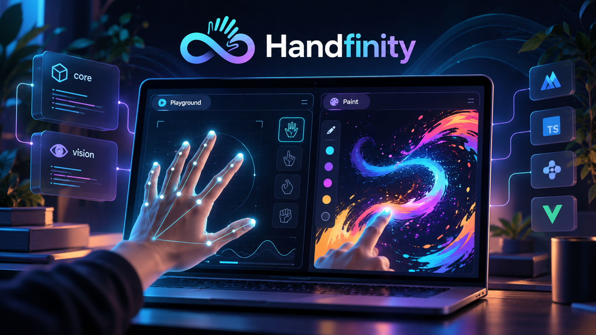

<a name="readme-top"></a>

<!-- PROJECT SHIELDS -->
[![Contributors][contributors-shield]][contributors-url]
[![Forks][forks-shield]][forks-url]
[![Stargazers][stars-shield]][stars-url]
[![Issues][issues-shield]][issues-url]
[![ISC License][license-shield]][license-url]
[![LinkedIn][linkedin-shield]][linkedin-url]

<!-- ABOUT THE PROJECT -->
# 🖐️ Handfinity

<p align="center">
  <a href="http://localhost:3000">
    
  </a>
</p>

### ℹ️ Description

**Handfinity** est une plateforme expérimentale de **reconnaissance des mains et des gestes par webcam** permettant de créer des interactions sans contact. Un [accueil immersif](apps/hub/README.md) donne accès à **Vision Playground** pour expérimenter et **Handfinity Paint** pour dessiner dans l'air. Les projets partagent le moteur de vision et restent aussi utilisables indépendamment.

- 🧭 **Connexion directe** : Accès à la webcam depuis le navigateur via les API Web, sans serveur de capture ni équipement spécialisé.
- 🎮 **Un accueil et deux expériences** :
  - **Hub** : Accueil animé sur `/`, avec une main holographique, des aperçus des projets et des emplacements « À venir ». Paint et Playground ont leurs propres routes : `/paint` et `/playground`.
  - **Vision Playground** : Visualisation en temps réel des mains, des points de repère et des transitions du geste de pincement. Une [zone de navigation expérimentale](apps/playground/README.md) permet de survoler quatre cartes avec un curseur lissé.
  - **Handfinity Paint** : Dessin sans contact sur un Canvas à partir des mouvements de l'index et du pouce.
  - **Packages partagés** : Réutilisation de la logique gestuelle (`@handfinity/core`) et de la vision (`@handfinity/vision`) dans les futures applications.
- 👓 **Interaction gestuelle sans contact** : Détection du pincement (*pinch*) pour démarrer, poursuivre et arrêter un tracé, sans souris ni écran tactile.
- ⚡ **Stack moderne** : Vue 3, Vite, TypeScript, Tailwind CSS v4 et npm Workspaces avec Node.js 24.
- 🎨 **Rendu Canvas 2D** : Affichage des repères des mains dans le Playground et superposition du dessin sur la vidéo dans Paint.
- 🔊 **Retour visuel en direct** : Curseur coloré, statut du geste et indication de l'état de la caméra pour comprendre les interactions.
- 🧹 **Outillage performant** : **Biome v2** pour le linting et le formatage, y compris les fichiers Vue avec prise en charge expérimentale.
- 🧪 **Qualité & Tests** : Tests **Vitest** dans Paint, core et vision, exécutés par le pipeline **Jenkins** ; tests E2E **Playwright** prévus.
- 🐳 **Développement Docker** : Trois services isolés, sources montées en volumes, hot reload Vite avec polling et démarrage commun via Docker Compose.

---

## ⚖️ Confidentialité & Utilisation de la Webcam

Handfinity est conçu pour expérimenter la vision par ordinateur tout en limitant la circulation des données caméra :
1. **Traitement côté navigateur** : La webcam est ouverte localement ; le traitement gestuel avec **MediaPipe Tasks Vision** s'exécute dans le navigateur, sans backend applicatif à ce stade.
2. **Contrôle explicite de la caméra** : L'utilisateur doit autoriser l'accès à la webcam et peut arrêter la session depuis les applications. Les ressources vidéo et le suivi sont libérés à l'arrêt.
3. **Précaution pour un déploiement public** :
   > *L'accès à la caméra nécessite un contexte sécurisé (HTTPS ou localhost). Handfinity n'a actuellement ni authentification, ni stockage distant des vidéos, ni base de données. Tout ajout futur de collecte devra être documenté explicitement.*

---

## 🎮 Moteur de Reconnaissance Gestuelle (Vision Partagée)

En complément des interfaces de démonstration, Handfinity repose sur un **moteur gestuel réutilisable** construit autour de MediaPipe et de deux packages internes :

- 🪟 **Acquisition vidéo locale** : Capture de la webcam avec démarrage et arrêt explicites, aperçu vidéo en miroir pour des interactions naturelles.
- 🖱️ **Suivi des mains en temps réel** : Détection des repères articulaires avec **MediaPipe Hand Landmarker**, accessibles sous forme de coordonnées pour les applications.
- 🎯 **Détection du pincement (*Pinch*)** : Analyse de la proximité du pouce et de l'index pour déclencher des événements gestuels structurés.
- 📌 **Traitement d'une main en V1** : Le Playground ne déclenche le geste que lorsqu'une seule main est détectée, pour éviter les interactions ambiguës.
- 🌐 **Packages partagés** : `@handfinity/core` contient la logique de détection ; `@handfinity/vision` regroupe le suivi des mains, la caméra et les sessions de geste.
- ⚡ **Actualisation continue** : Analyse des images vidéo via `requestAnimationFrame`, avec mise à jour des repères et états dans l'interface.
- 🔌 **Gestion du cycle de vie** : Initialisation, arrêt de la caméra, fermeture du tracker et remise à zéro des états lorsque la session se termine.
- ⌨️ **Événements & Commandes** :
  - **`pinch:start`** : Le pouce et l'index se rejoignent ; début de l'interaction.
  - **`pinch:move`** : La main se déplace tout en maintenant le pincement ; mise à jour du tracé.
  - **`pinch:end`** : Le pincement est relâché ; fin du trait.
  - **Start / Stop camera** : Active ou libère explicitement la webcam depuis chaque application.

### 🏆 Handfinity Paint & Dessin dans l'Air

Dans **Handfinity Paint**, le flux de la webcam et le **Canvas HTML5** sont superposés pour transformer les gestes de la main en tracés visibles directement dans le navigateur :
- **Démarrage manuel** : Un bouton lance ou arrête la caméra sans activation automatique à l'ouverture de la page.
- **Aperçu en miroir** : La vidéo est inversée horizontalement pour correspondre aux mouvements naturels de l'utilisateur.
- **Curseur gestuel** : Un cercle vide suit l'index au repos ; il s'agrandit et affiche la couleur du trait pendant le dessin. Après Clear pendant un pincement, un cercle pointillé invite à relâcher les doigts.
- **Statut du dessin** : Une consigne accompagne chaque état : caméra arrêtée ou en cours de démarrage, attente d'une main, prêt à dessiner, tracé actif, perte de suivi et relâchement nécessaire.
- **Tracé lissé** : Le curseur et le pinceau partagent une position filtrée ; des courbes quadratiques relient les points sur un Canvas 2D. Les cinq étapes de [Paint V1.1](apps/paint/README.md) sont implémentées, avec une séparation entre interface, session caméra et gestion du dessin.
- **Pinceau réglable** : Sélecteur de couleur, épaisseur de 1 à 40 pixels et aperçu. Chaque trait conserve ses réglages jusqu'à sa fin ; le pinceau initial est bleu clair et mesure 6 pixels.
- **Effacement immédiat** : Le bouton **Clear** vide la surface de dessin sans redémarrer la webcam.
- **Undo / Redo** : Annulation par trait et rétablissement avec le style d'origine. Clear est également annulable ; les commandes d'historique sont disponibles après relâchement du pincement.
- **Export en 1 clic** : Le bouton **Export PNG** télécharge le résultat dans `handfinity-paint.png`.
- **Sans stockage serveur** : Le dessin demeure en mémoire dans l'onglet et n'est conservé que si l'utilisateur l'exporte.

### ⏱️ Réactivité & Fiabilité de la Détection
- **Analyse vidéo continue** : Le Playground traite les nouvelles images de la caméra et dessine les connexions entre les points de repère pour visualiser les mouvements.
- **Transitions gestuelles explicites** : Les événements de début, déplacement et fin de pincement évitent de prolonger un trait après relâchement ; la stabilité dépend aussi de la webcam, de l'éclairage et des mouvements.

### Lancement et distribution des applications

#### En développement :
```bash
# Lancer l'accueil sur http://localhost:3000
# Paint : /paint ; Playground : /playground
npm run dev

# Facultatif : lancer les applications autonomes
npm run dev -w paint
# Paint : http://localhost:3001
npm run dev -w playground
# Playground : http://localhost:3002
```
Le hub suffit pour accéder aux deux expériences depuis une même application.
**Docker Compose** permet également de démarrer les trois services avec une seule commande.

#### En production (Build statique des applications) :
Pour compiler les interfaces web **sans imposer Node.js aux visiteurs** :
```bash
npm run build
```
Cette commande compile les applications Vue avec Vite et produit leurs fichiers statiques dans les dossiers de sortie :
- **Hub** : Build dans `apps/hub/dist/`, contenant l'accueil et les deux expériences avec leurs routes.
- **Playground** : Build dans `apps/playground/dist/`, destiné aux essais et à l'observation des gestes.
- **Paint** : Build dans `apps/paint/dist/`, destiné à l'expérience de dessin sans contact.
- **Distribution web** : Les fichiers générés peuvent être servis par un serveur HTTP statique, par exemple Nginx derrière Caddy avec HTTPS.

> [!NOTE]
> **Attention à l'accès webcam en production :**
> Les navigateurs modernes demandent une autorisation explicite pour utiliser la caméra et réservent généralement `getUserMedia()` aux pages servies en **HTTPS** ou sur **localhost**. Le build Vite ne suffit pas à lui seul à configurer l'hébergement public.

---

## 🚀 Progression & Roadmap

- [x] **v0 — Socle, Infra & Monorepo**
  - [x] Configuration Vue 3 + Vite + TypeScript + Tailwind CSS v4
  - [x] Initialisation du monorepo avec **npm Workspaces**
  - [x] Création de `apps/playground` et `apps/paint`
  - [x] Création des packages `@handfinity/core` et `@handfinity/vision`
  - [x] Configuration de **Biome v2** pour le linting et le formatage
  - [x] Mise en place de **Docker Compose** pour le développement
- [x] **v0.5 — Capture, Tracking & Playground**
  - [x] Capture et arrêt du flux webcam depuis le navigateur
  - [x] Intégration **MediaPipe Tasks Vision** pour détecter les mains
  - [x] Affichage des points de repère et des connexions sur Canvas
  - [x] Compteur des mains détectées dans le Playground
  - [x] Détection des transitions `pinch:start`, `pinch:move` et `pinch:end`
  - [x] Indicateur de pincement actif et journalisation des transitions
- [x] **v1 — Handfinity Paint : Dessin Sans Contact**
  - [x] Application Paint distincte du Playground
  - [x] Démarrage / arrêt de la webcam à la demande
  - [x] Superposition vidéo et Canvas avec coordonnées adaptées au miroir
  - [x] Dessin à l'index grâce au maintien du pincement
  - [x] Indicateur de position et de statut du geste
  - [x] Effacement de la surface et export de l'image en PNG
- [x] **v1.1 — Expérience de Développement & Outillage**
  - [x] Environnements de développement Vite dédiés aux applications
  - [x] Hot reload Docker avec bind mounts et polling
  - [x] Ports distincts : **3000 (Hub)**, **3001 (Paint)** et **3002 (Playground)**
  - [x] Volumes `node_modules` séparés pour chaque service
  - [x] Interface responsive avec Tailwind CSS
  - [x] Scripts npm de lint, formatage, vérification et compilation
  - [x] Cible Docker `dev` utilisant Node.js 24
- [x] **v1.3 — Pipeline CI Jenkins & Tests du Core**
  - [x] Pipeline Jenkins défini dans `Jenkinsfile`
  - [x] Exécution dans un agent Docker Node.js 24
  - [x] Installation reproductible des dépendances via `npm ci`
  - [x] Étapes automatisées **Lint** et **Format check**
  - [x] Tests **Vitest** de Paint, `@handfinity/core` et `@handfinity/vision`
  - [x] Build des trois applications et notifications Telegram configurées dans le pipeline
- [ ] **Accueil immersif et navigation gestuelle**
  - [x] Zone de pointage et survol expérimental dans Playground
  - [x] Accueil immersif distinct sur `/`, routes `/paint` et `/playground`
  - [x] Ambiance animée, pause et respect de la réduction des mouvements
  - [x] Retour dans Paint avec dessin conservé et caméra arrêtée
  - [ ] Validation et défilement gestuels dans Playground
  - [ ] Branchement des gestes sur l'accueil
- [ ] **Déploiement public sur VPS — à finaliser**
  - [ ] Valider la cible Docker `prod` avec la configuration Nginx
  - [ ] Préparer l'image ou le service de production du hub
  - [ ] Publier le hub et ses expériences derrière Caddy en HTTPS
  - [ ] Vérifier les permissions de webcam sur l'URL publique
  - [ ] Tester l'expérience sur plusieurs navigateurs et formats d'écran
  - [ ] Ajouter une véritable capture d'écran au README
- [ ] **v1.5 — Gestes Avancés & Nouveaux Modules**
  - [ ] Ajouter d'autres gestes reconnus au-delà du pincement
  - [ ] Améliorer le filtrage et la stabilité du suivi gestuel
  - [ ] Ajouter des outils de dessin avancés (couleurs, épaisseur, gomme)
  - [ ] Étendre les interactions vers la 3D, le contrôle d'applications et, à terme, la domotique ou la robotique

---

## Utiliser Handfinity

1. **Choisir une expérience** : depuis l'accueil, ouvrez **Vision Playground** ou **Handfinity Paint** au clic, au toucher ou au clavier. Cliquez ensuite sur **Start camera** et autorisez le navigateur à accéder à la webcam.
2. **Explorer la détection** : dans le Playground, observez les points articulaires de la main et les connexions. Rapprochez le pouce et l'index pour voir le statut **PINCH ACTIVE**.
3. **Dessiner sans contact** : dans Paint, rapprochez le pouce et l'index pour commencer un trait, déplacez la main en maintenant le geste et relâchez pour arrêter de dessiner.
4. **Effacer ou exporter** : utilisez **Clear** pour recommencer, ou **Export PNG** pour enregistrer le dessin. Arrêtez ensuite la webcam avec **Stop camera**.

**Caméra et aide :** la caméra n'est pas activée automatiquement. Quitter un projet ferme sa session ; le dessin et l'historique de Paint restent en mémoire pendant la navigation dans le hub, jusqu'au rechargement de l'onglet. Un message s'affiche en cas d'échec d'initialisation ou d'indisponibilité du périphérique. Le Playground est l'outil privilégié pour comprendre la détection avant d'utiliser Paint.

**Lecture des gestes :** les repères fournis par MediaPipe sont des coordonnées estimées à partir de l'image. La reconnaissance dépend de la visibilité de la main, de la lumière et de la qualité du flux vidéo. Dans le Playground V1, le pincement est évalué sur une seule main détectée.

---

## 💻 Installation & Démarrage

### Prérequis
* **Node.js 24** et npm pour le développement local, les tests et la CI Jenkins ; Docker utilise également une image Node.js 24.
* Une webcam fonctionnelle et un navigateur récent autorisant `getUserMedia()` sur localhost ou en HTTPS.

### Option A : Lancer en local

```bash
# 1. Cloner le dépôt
git clone https://github.com/nlabrazi/handfinity.git
cd handfinity

# 2. Installer les dépendances du monorepo
npm ci

# 3. Lancer le hub et accéder aux deux expériences
npm run dev
# Accueil : http://localhost:3000
# Paint : http://localhost:3000/paint
# Playground : http://localhost:3000/playground
```

### Option B : Développer avec Docker

Cette configuration utilise **Docker Compose** et trois services indépendants :
`hub`, `playground` et `paint`. Chaque conteneur démarre Vite avec le code source monté
en volume, sans dépendance à un backend ni à une base de données.
Le hub écoute sur le port **3000**, Paint sur **3001** et Playground sur **3002**,
exposés sur la machine hôte. Pour travailler uniquement dans le hub,
`docker compose up --build hub` suffit.

La variable `CHOKIDAR_USEPOLLING=true` est définie dans `docker-compose.yml` pour
fiabiliser la détection des fichiers modifiés, notamment avec Docker / WSL2.

```bash
docker compose up --build
# Accueil et projets : http://localhost:3000
# Paint : http://localhost:3001
# Playground : http://localhost:3002
```

Les dossiers `node_modules` utilisés par les trois conteneurs résident dans des
volumes Docker distincts, tandis que le dépôt est monté dans `/app`.
Les services exécutent `npm ci` au démarrage afin de disposer des dépendances.

Le hot reload est actif : les modifications des composants Vue et des styles
sont appliquées dans le navigateur sans reconstruire l'image. La surveillance des
fichiers utilise le polling Vite pour fonctionner en environnement conteneurisé.
Après une modification de `docker-compose.yml`, réappliquer la configuration avec
`docker compose up -d --build`.

Le navigateur doit afficher `[vite] connected` dans sa console. Une modification
valide de `apps/paint/src/App.vue` doit ensuite provoquer une mise à jour HMR.
En cas d'erreur Vue ou TypeScript, vérifier la console du navigateur et les
logs avec `docker compose logs -f hub`, `paint` ou `playground`.

Après l'ajout d'une dépendance dans le monorepo, synchroniser le lockfile et
recréer le service concerné pour actualiser son volume `node_modules` :

```bash
npm install
docker compose up -d --build --force-recreate
```

---

## 🌐 Déploiement sur VPS et exécution côté navigateur

**État actuel : Handfinity dispose d'un hub et de deux expériences fonctionnelles
en local, avec une configuration Docker pour le développement. Le déploiement public
sur VPS avec HTTPS reste à finaliser.**

Aujourd'hui, les interactions passent directement par le navigateur :
la vidéo est captée localement, analysée avec MediaPipe, puis utilisée pour
mettre à jour le Canvas de l'application.

```text
Webcam → Navigateur → MediaPipe / @handfinity/vision → Gestes → Canvas
```

Aucune API distante n'est requise pour traiter les gestes ; les packages
`@handfinity/core` et `@handfinity/vision` s'exécutent côté client.
Un VPS peut héberger les fichiers statiques sans recevoir les images de webcam.
C'est notamment la différence entre **hébergement de l'interface** et
**traitement de la vidéo**.

L'architecture prévue pour une publication accessible sur Internet est :

```text
Navigateur utilisateur                  VPS
Webcam + MediaPipe ← HTTPS ← Caddy ← Nginx / Fichiers statiques Vue
```

Le VPS servira les applications compilées. Le suivi gestuel restera dans le
navigateur des utilisateurs : aucune webcam, aucun flux vidéo et aucun port
local ne devront être exposés par leur ordinateur. Les autorisations caméra
resteront gérées par le navigateur de chacun.

Le fichier `docker-compose.yml` actuel lance **les serveurs de développement**
avec hot reload ; ce n'est pas une configuration de production. Le `Dockerfile`
comporte une cible `prod` basée sur Nginx qui construit le hub par défaut. Elle
copie le fichier `nginx.conf` de la racine, avec un fallback vers `index.html`
pour les routes du hub. L'image de production reste à valider.
La configuration Caddy/HTTPS et le déploiement public
restent également à mettre en place.

---

## 🛠️ Scripts Disponibles

| Commande | Description |
| :--- | :--- |
| `npm run dev` | Démarre le **Hub** sur le port 3000, avec `/`, `/paint` et `/playground` |
| `npm run dev -w paint` | Démarre **Handfinity Paint** sur le port 3001 |
| `npm run dev -w playground` | Démarre **Vision Playground** sur le port 3002 |
| `npm run build` | Compile **Playground**, **Paint** et le **Hub** pour la production |
| `npm run lint` | Exécute le linter **Biome** sur l'ensemble du monorepo |
| `npm run format` | Formate le code avec **Biome** |
| `npm run format:check` | Vérifie le formatage sans modifier les fichiers (utilisé en CI) |
| `npm run check` | Lance la vérification complète `biome check .` |
| `npm test -w @handfinity/core` | Exécute les tests unitaires **Vitest** du package core |
| `npm test` | Exécute les tests **Vitest** de Paint, core et vision |
| `docker compose up --build` | Démarre les trois applications en développement avec hot reload |

---

## 📄 Licence & Contact

La métadonnée du projet indique actuellement la licence **ISC** dans `package.json`. Aucun fichier de licence dédié n'est encore présent à la racine du dépôt.

- 👤 **Nabil Labrazi** : [Portfolio](https://nabster.dev) • [LinkedIn](https://linkedin.com/in/nabil-labrazi) • [Email](mailto:na.labrazi@gmail.com)

[contributors-shield]: https://img.shields.io/github/contributors/nlabrazi/handfinity.svg?style=for-the-badge
[contributors-url]: https://github.com/nlabrazi/handfinity/graphs/contributors
[forks-shield]: https://img.shields.io/github/forks/nlabrazi/handfinity.svg?style=for-the-badge
[forks-url]: https://github.com/nlabrazi/handfinity/network/members
[stars-shield]: https://img.shields.io/github/stars/nlabrazi/handfinity.svg?style=for-the-badge
[stars-url]: https://github.com/nlabrazi/handfinity/stargazers
[issues-shield]: https://img.shields.io/github/issues/nlabrazi/handfinity.svg?style=for-the-badge
[issues-url]: https://github.com/nlabrazi/handfinity/issues
[license-shield]: https://img.shields.io/badge/License-ISC-blue.svg?style=for-the-badge
[license-url]: https://github.com/nlabrazi/handfinity/blob/master/package.json
[linkedin-shield]: https://img.shields.io/badge/-LinkedIn-black.svg?style=for-the-badge&logo=linkedin&colorB=555
[linkedin-url]: https://linkedin.com/in/nabil-labrazi
